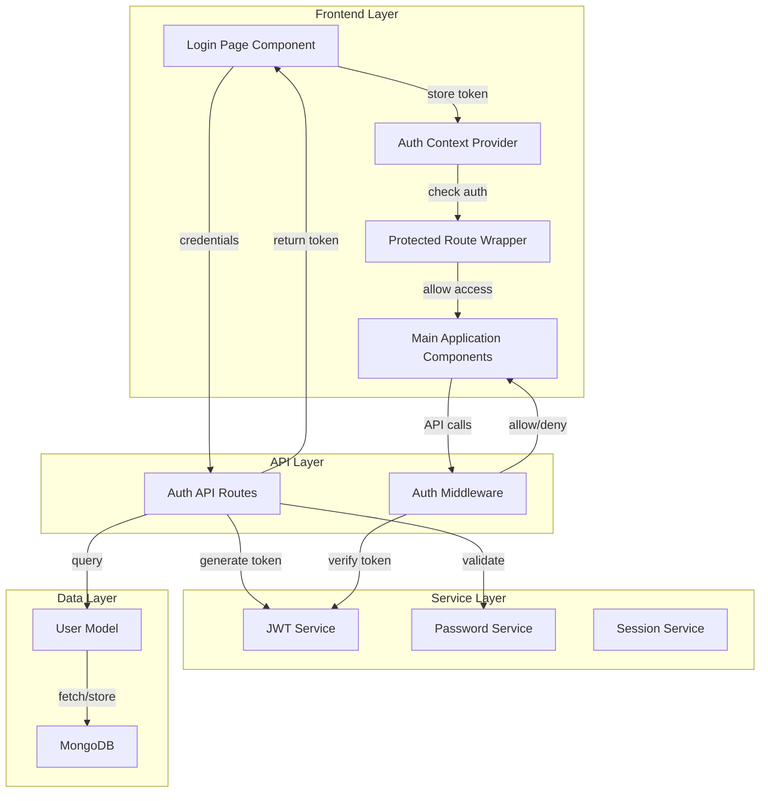

# Design Document: Authentication Login Feature

## Overview

The authentication login feature provides secure access control for the M Marine Services invoice management system. It implements a modern, visually appealing login interface with marine/ocean theming, combined with robust backend authentication using JWT tokens and bcrypt password hashing. The system follows a single-owner authentication model where one business owner has exclusive access to the application.

### Key Design Goals

1. **Security First**: Implement industry-standard authentication practices including password hashing, JWT tokens, and server-side validation
2. **User Experience**: Create a smooth, animated login experience with clear feedback and error handling
3. **Session Persistence**: Maintain authenticated sessions across browser sessions using localStorage
4. **Route Protection**: Ensure all application routes are protected and only accessible to authenticated users
5. **Marine Aesthetic**: Deliver a visually cohesive ocean-themed interface with glassmorphism effects and wave animations

### Technology Stack

**Frontend:**
- React 18.2.0 for UI components and state management
- React Context API for authentication state management
- CSS3 for animations and glassmorphism effects
- Axios for HTTP requests

**Backend:**
- Node.js with Express.js for API endpoints
- MongoDB with Mongoose for credential storage
- jsonwebtoken library for JWT generation and verification
- bcryptjs library for password hashing

**Testing:**
- fast-check for property-based testing of authentication logic
- Jest (via react-scripts) for unit and integration testing

## Architecture

### System Components

The authentication system consists of four primary layers:



### Authentication Flow

**Login Flow:**
1. User enters credentials on Login Page
2. Login Page sends POST request to `/api/auth/login`
3. Backend retrieves user from database
4. Backend compares password hash using bcrypt
5. If valid, backend generates JWT token with 24-hour expiration
6. Token returned to frontend
7. Frontend stores token in localStorage and Auth Context
8. Frontend redirects to Main Application

**Protected Route Access Flow:**
1. User attempts to access protected route
2. Protected Route Wrapper checks Auth Context for token
3. If no token exists, redirect to Login Page
4. If token exists, render protected component
5. Protected component makes API call with token in Authorization header
6. Backend middleware validates JWT signature and expiration
7. If valid, API processes request; if invalid, returns 401 Unauthorized
8. Frontend intercepts 401, clears token, redirects to Login Page

**Session Persistence Flow:**
1. User closes browser with active session
2. Token remains in localStorage
3. User reopens application
4. App initialization checks localStorage for token
5. If token found, Auth Context restores authenticated state
6. User sees Main Application without re-login
7. Backend validates token on first API call

## Components and Interfaces

### Frontend Components

#### 1. LoginPage Component

**Responsibility**: Render login form and handle user authentication

**State:**
```typescript
interface LoginPageState {
  username: string;
  password: string;
  error: string | null;
  isLoading: boolean;
}
```

**Props**: None (top-level route component)

**Key Methods:**
- `handleSubmit(event)`: Validates input and calls authentication API
- `handleInputChange(field, value)`: Updates form state and clears errors
- `validateForm()`: Checks for empty fields before submission

**Rendering Logic:**
- Display marine-themed background with animated waves
- Show glassmorphism login card with logo, input fields, and submit button
- Conditionally render error messages with shake animation
- Show loading spinner during authentication

#### 2. AuthContext Component

**Responsibility**: Manage global authentication state and provide auth utilities

**Context Value:**
```typescript
interface AuthContextValue {
  isAuthenticated: boolean;
  token: string | null;
  user: { username: string } | null;
  login: (token: string, username: string) => void;
  logout: () => void;
  checkAuth: () => boolean;
}
```

**Implementation:**
- Use React.createContext and useState for state management
- Initialize by checking localStorage for existing token
- Provide login() to store token and update state
- Provide logout() to clear token and reset state
- Provide checkAuth() to validate token existence

#### 3. ProtectedRoute Component

**Responsibility**: Wrap routes requiring authentication and redirect if unauthenticated

**Props:**
```typescript
interface ProtectedRouteProps {
  children: React.ReactNode;
}
```

**Logic:**
```javascript
function ProtectedRoute({ children }) {
  const { isAuthenticated } = useAuth();
  
  if (!isAuthenticated) {
    return <Navigate to="/login" replace />;
  }
  
  return children;
}
```

#### 4. LogoutButton Component

**Responsibility**: Provide logout functionality in Main Application header

**Props**: None

**Behavior:**
- Render button with marine theme styling
- On click, call `logout()` from Auth Context
- Trigger navigation to Login Page

### Backend Components

#### 1. Auth Controller

**Responsibility**: Handle authentication API endpoints

**Endpoints:**

**POST /api/auth/login**
- Request Body: `{ username: string, password: string }`
- Response Success (200): `{ token: string, username: string }`
- Response Error (401): `{ error: string }`
- Response Error (400): `{ error: string }` (validation errors)

**Logic:**
```javascript
async function login(req, res) {
  const { username, password } = req.body;
  
  // Validate input
  if (!username || !password) {
    return res.status(400).json({ error: 'Username and password required' });
  }
  
  // Find user
  const user = await User.findOne({ username });
  if (!user) {
    return res.status(401).json({ error: 'Invalid username or password' });
  }
  
  // Verify password
  const isValid = await bcrypt.compare(password, user.passwordHash);
  if (!isValid) {
    return res.status(401).json({ error: 'Invalid username or password' });
  }
  
  // Generate token
  const token = jwt.sign(
    { username: user.username },
    process.env.JWT_SECRET,
    { expiresIn: '24h' }
  );
  
  res.json({ token, username: user.username });
}
```

#### 2. Auth Middleware

**Responsibility**: Validate JWT tokens on protected API routes

**Implementation:**
```javascript
function authMiddleware(req, res, next) {
  const authHeader = req.headers.authorization;
  
  if (!authHeader || !authHeader.startsWith('Bearer ')) {
    return res.status(401).json({ error: 'No token provided' });
  }
  
  const token = authHeader.substring(7);
  
  try {
    const decoded = jwt.verify(token, process.env.JWT_SECRET);
    req.user = decoded;
    next();
  } catch (error) {
    return res.status(401).json({ error: 'Invalid or expired token' });
  }
}
```

**Usage**: Apply to all existing invoice and item routes

#### 3. Axios Interceptor

**Responsibility**: Automatically attach JWT token to outgoing requests and handle 401 errors

**Implementation:**
```javascript
// Request interceptor
axios.interceptors.request.use(
  (config) => {
    const token = localStorage.getItem('authToken');
    if (token) {
      config.headers.Authorization = `Bearer ${token}`;
    }
    return config;
  },
  (error) => Promise.reject(error)
);

// Response interceptor
axios.interceptors.response.use(
  (response) => response,
  (error) => {
    if (error.response?.status === 401) {
      localStorage.removeItem('authToken');
      window.location.href = '/login';
    }
    return Promise.reject(error);
  }
);
```

## Data Models

### User Model

**Schema:**
```javascript
const userSchema = new mongoose.Schema({
  username: {
    type: String,
    required: true,
    unique: true,
    trim: true,
    minlength: 3,
    maxlength: 50
  },
  passwordHash: {
    type: String,
    required: true
  },
  createdAt: {
    type: Date,
    default: Date.now
  }
});
```

**Indexes:**
- Primary: `_id` (default MongoDB ObjectId)
- Unique: `username`

**Notes:**
- Only one user record will exist in the system (single-owner model)
- Password is never stored in plain text
- createdAt used for audit purposes

### JWT Token Payload

**Structure:**
```typescript
interface JWTPayload {
  username: string;
  iat: number;  // issued at timestamp
  exp: number;  // expiration timestamp (24 hours)
}
```

**Configuration:**
- Algorithm: HS256 (HMAC with SHA-256)
- Secret: Stored in environment variable `JWT_SECRET`
- Expiration: 24 hours from issuance

### LocalStorage Schema

**Key: `authToken`**
- Type: string
- Value: JWT token
- Lifespan: Persists until logout or manual clear

## Correctness Properties

*A property is a characteristic or behavior that should hold true across all valid executions of a system—essentially, a formal statement about what the system should do. Properties serve as the bridge between human-readable specifications and machine-verifiable correctness guarantees.*

The authentication system has several universal properties that must hold across all inputs and executions. These properties focus on the core authentication logic that can be tested independently of UI and external dependencies.

### Property 1: Password Hash Verification Consistency

*For any* valid password string, hashing that password and then comparing it against the generated hash SHALL always return true.

**Validates: Requirement 2.3, 2.4**

**Rationale**: This property ensures that the bcrypt hashing and comparison functions work correctly as inverse operations. If a password generates a hash, that same password must verify against that hash. This is fundamental to authentication correctness.

### Property 2: JWT Token Round-Trip Integrity

*For any* valid username string, generating a JWT token with that username and then decoding that token SHALL return the original username without modification.

**Validates: Requirement 2.5, 8.6, 8.7**

**Rationale**: This property verifies that JWT token generation and verification preserve data integrity. The username embedded in the token must survive the encode-decode cycle without corruption or data loss.

### Property 3: Token Expiration Enforcement

*For any* JWT token, if the current time is greater than the token's expiration timestamp, then token verification SHALL reject the token as expired.

**Validates: Requirement 3.6, 3.7**

**Rationale**: This property ensures that expired tokens are never accepted as valid, preventing indefinite session persistence and enforcing the 24-hour session timeout requirement.

### Property 4: Invalid Token Rejection

*For any* string that is not a valid JWT token (malformed, wrong signature, or tampered payload), token verification SHALL reject the token and not grant authentication.

**Validates: Requirement 8.8**

**Rationale**: This property ensures that the system correctly distinguishes between valid and invalid tokens, preventing authentication bypass through token manipulation or forged tokens.

### Property 5: Empty Input Validation

*For any* authentication request where username or password is empty (empty string, null, undefined, or whitespace-only), the validation SHALL reject the request before attempting database lookup or password comparison.

**Validates: Requirement 2.6, 2.7, 2.8**

**Rationale**: This property ensures input validation occurs before expensive operations, preventing unnecessary database queries and maintaining consistent error messaging for empty inputs.

### Property 6: Session Storage Idempotence

*For any* authentication token, storing it in session storage and then immediately retrieving it SHALL return the exact same token string without modification.

**Validates: Requirement 3.1, 3.2**

**Rationale**: This property ensures that session storage operations preserve token integrity. A token stored and retrieved must be identical, as any modification would invalidate the JWT signature.

### Property 7: Authentication State Consistency

*For any* authenticated session, if a valid token exists in storage, then the isAuthenticated state SHALL be true; if no token exists or the token is invalid, then isAuthenticated SHALL be false.

**Validates: Requirement 3.3, 4.1**

**Rationale**: This property ensures the authentication state accurately reflects token presence and validity, which is critical for route protection and UI rendering decisions.

## Error Handling

### Frontend Error Handling

**Network Errors:**
- Catch axios request failures
- Display user-friendly message: "Unable to connect. Please try again."
- Log error details to console for debugging
- Reset form to allow retry

**Validation Errors:**
- Check for empty username: display "Username is required"
- Check for empty password: display "Password is required"
- Prevent form submission until both fields have values
- Clear errors when user begins typing

**Authentication Errors:**
- 401 response: display "Invalid username or password"
- Generic error message for security (don't reveal which field is wrong)
- Shake animation on error message appearance
- Clear error on next form input change

**Token Errors:**
- Invalid token in storage: clear and redirect to login
- Expired token on API call: catch 401, clear storage, redirect
- Missing token for protected route: immediate redirect to login

### Backend Error Handling

**Database Errors:**
```javascript
try {
  const user = await User.findOne({ username });
} catch (error) {
  console.error('Database error:', error);
  return res.status(500).json({ error: 'Server error. Please try again.' });
}
```

**JWT Errors:**
```javascript
try {
  const decoded = jwt.verify(token, process.env.JWT_SECRET);
} catch (error) {
  if (error.name === 'TokenExpiredError') {
    return res.status(401).json({ error: 'Token expired' });
  }
  if (error.name === 'JsonWebTokenError') {
    return res.status(401).json({ error: 'Invalid token' });
  }
  return res.status(401).json({ error: 'Authentication failed' });
}
```

**Bcrypt Errors:**
```javascript
try {
  const isValid = await bcrypt.compare(password, user.passwordHash);
} catch (error) {
  console.error('Password comparison error:', error);
  return res.status(500).json({ error: 'Server error. Please try again.' });
}
```

### Error Message Principles

1. **Security**: Never reveal whether username or password was incorrect
2. **User-Friendly**: Use plain language, avoid technical jargon
3. **Actionable**: Tell user what they can do to fix the problem
4. **Consistent**: Use same styling and positioning for all errors
5. **Transient**: Clear errors when user takes corrective action

## Testing Strategy

### Dual Testing Approach

The authentication feature requires both property-based testing and example-based unit testing to achieve comprehensive coverage:

**Property-Based Tests**: Cover universal properties of authentication logic (password hashing, JWT operations, validation rules)

**Unit Tests**: Cover specific scenarios, integration points, UI behavior, and edge cases

### Property-Based Testing

**Library**: fast-check (already in devDependencies)

**Configuration**: Minimum 100 iterations per property test

**Test Organization**: Create separate test files for each service layer
- `passwordService.property.test.js` - password hashing properties
- `jwtService.property.test.js` - JWT token properties
- `sessionService.property.test.js` - session storage properties
- `authValidation.property.test.js` - input validation properties

**Property Test Requirements**:

Each property test MUST:
1. Run at least 100 iterations with randomized inputs
2. Include a comment tag referencing the design property
3. Use fast-check generators appropriate for the input domain
4. Test the authentication logic in isolation (mocked dependencies)

**Example Property Test Structure**:
```javascript
// Feature: authentication-login, Property 1: Password Hash Verification Consistency
test('Password hash verification round-trip', () => {
  fc.assert(
    fc.asyncProperty(
      fc.string({ minLength: 1, maxLength: 72 }), // bcrypt limit
      async (password) => {
        const hash = await bcrypt.hash(password, 10);
        const isValid = await bcrypt.compare(password, hash);
        expect(isValid).toBe(true);
      }
    ),
    { numRuns: 100 }
  );
});
```

**Property Test Coverage**:

1. **Password Hashing** (Property 1):
   - Generate random password strings (1-72 chars)
   - Hash and verify round-trip
   - Assert verification always succeeds

2. **JWT Round-Trip** (Property 2):
   - Generate random username strings
   - Create token, decode token
   - Assert username preserved

3. **Token Expiration** (Property 3):
   - Generate tokens with various expiration times
   - Test verification at different time offsets
   - Assert expired tokens rejected

4. **Invalid Token Handling** (Property 4):
   - Generate malformed JWT strings
   - Generate tokens with wrong signatures
   - Generate tokens with tampered payloads
   - Assert all rejected

5. **Input Validation** (Property 5):
   - Generate empty strings, whitespace, null, undefined
   - Test validation function
   - Assert all invalid inputs rejected

6. **Session Storage** (Property 6):
   - Generate random token strings
   - Store and retrieve from localStorage mock
   - Assert token integrity preserved

7. **Auth State Consistency** (Property 7):
   - Generate various token states (valid, invalid, missing)
   - Test authentication state derivation
   - Assert state matches token validity

### Unit Testing

**Test Files**:
- `LoginPage.test.js` - UI component behavior
- `AuthContext.test.js` - context provider logic
- `ProtectedRoute.test.js` - route protection logic
- `authController.test.js` - backend endpoint behavior
- `authMiddleware.test.js` - JWT middleware behavior

**Unit Test Coverage**:

**Frontend Components**:
1. LoginPage renders correctly with all elements
2. Form validation prevents submission with empty fields
3. Error messages display and clear appropriately
4. Loading state shows spinner during authentication
5. Successful login redirects to main application
6. Failed login displays error message

**Auth Context**:
1. Initial state loads token from localStorage
2. login() method stores token and updates state
3. logout() method clears token and resets state
4. checkAuth() returns correct boolean

**Protected Routes**:
1. Unauthenticated users redirected to login
2. Authenticated users see protected content
3. Navigation works after authentication

**Backend**:
1. POST /api/auth/login with valid credentials returns token
2. POST /api/auth/login with invalid username returns 401
3. POST /api/auth/login with invalid password returns 401
4. POST /api/auth/login with missing fields returns 400
5. Auth middleware accepts valid tokens
6. Auth middleware rejects invalid tokens
7. Auth middleware rejects expired tokens
8. Auth middleware rejects missing tokens

### Integration Testing

**Scenarios**:
1. Complete login flow from form submission to main app access
2. Session persistence across page reloads
3. Logout flow clearing state and redirecting
4. Protected API calls with token authentication
5. Token expiration handling and re-login
6. Concurrent request handling with same token

### Visual and Accessibility Testing

**Manual Testing Checklist**:
- [ ] Wave animations play smoothly
- [ ] Glassmorphism effects render correctly
- [ ] Form inputs have clear focus states
- [ ] Error messages animate with shake effect
- [ ] Loading spinner displays during authentication
- [ ] Transition to main app is smooth
- [ ] Responsive layout works on mobile, tablet, desktop
- [ ] Keyboard navigation works (Tab, Enter)
- [ ] Password managers can autofill
- [ ] Color contrast meets WCAG 4.5:1 ratio

### Test Execution Strategy

1. **Development**: Run unit and property tests on file changes
2. **Pre-commit**: Run all tests before committing code
3. **CI/CD**: Run full test suite on pull requests
4. **Manual**: Perform visual and accessibility testing before release

### Coverage Goals

- **Line Coverage**: Minimum 80% for authentication logic
- **Branch Coverage**: Minimum 80% for conditional logic
- **Property Coverage**: All 7 correctness properties implemented and passing
- **Integration Coverage**: All critical user flows tested end-to-end
