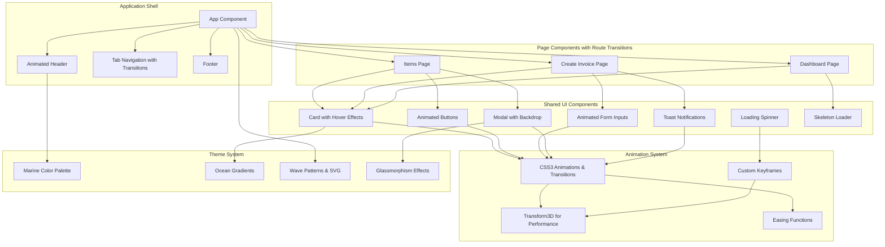
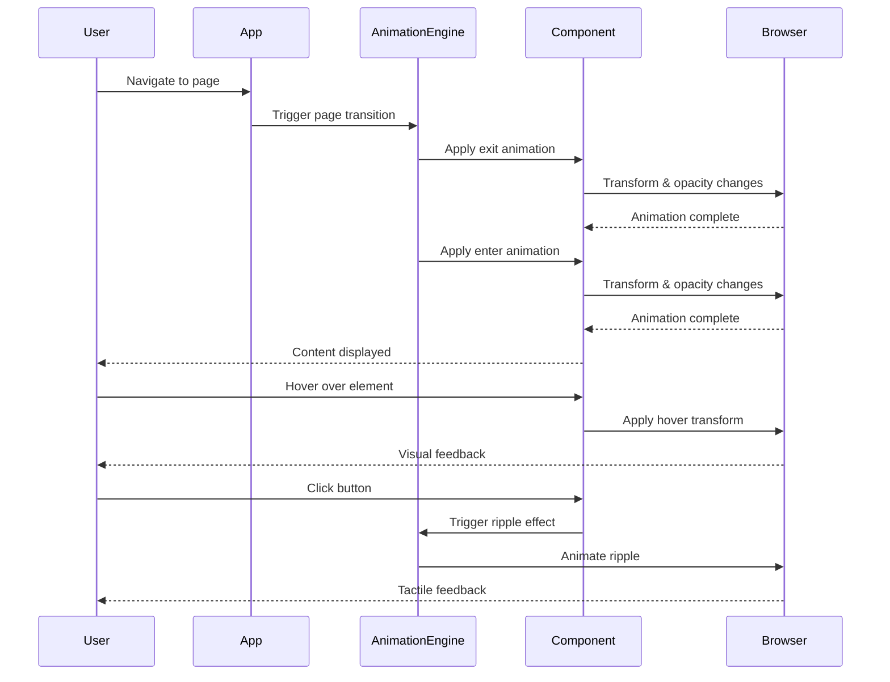
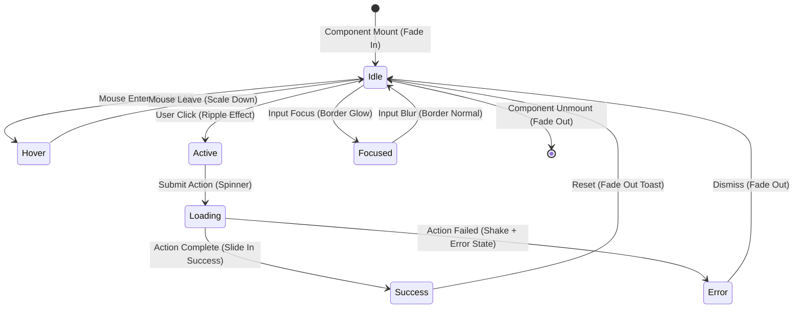

# Design Document: Modern UI Animations & Enhancements

## Overview

This design document outlines a comprehensive UI enhancement plan for the M Marine Services Invoice Management System. The goal is to transform the current functional interface into a modern, professional SaaS-grade application with smooth animations, delightful micro-interactions, and a strengthened maritime theme. The design focuses on enhancing user experience through visual feedback, reducing cognitive load with clear visual hierarchies, and creating an engaging interface that reflects the quality and professionalism of marine services.

The enhancement strategy employs a progressive enhancement approach, ensuring the application remains fully functional while layering on sophisticated animations and visual effects. All animations are hardware-accelerated where possible, respect user preferences (prefers-reduced-motion), and enhance rather than distract from core functionality.

## Architecture

### High-Level Component Architecture



### Animation Flow Architecture



### State Transition Architecture



## Components and Interfaces

### 1. Animated Page Transitions

**Purpose**: Smooth transitions between Items, Create Invoice, and Dashboard pages

**Component Structure**:
```javascript
interface PageTransitionProps {
  currentPage: 'items' | 'invoice' | 'dashboard'
  children: React.ReactNode
  transitionDuration?: number // default: 300ms
  transitionType?: 'fade' | 'slide' | 'fade-slide' // default: 'fade-slide'
}
```

**Animation Specifications**:
- **Exit Animation**: 150ms fade out + slide left (opacity 1→0, translateX 0→-20px)
- **Enter Animation**: 150ms fade in + slide right (opacity 0→1, translateX 20px→0)
- **Timing Function**: `cubic-bezier(0.4, 0.0, 0.2, 1)` (Material Design standard)

**Visual Behavior**:
- Current page fades out and slides left
- New page fades in and slides right
- Total transition time: 300ms with 0ms gap
- Pages stack using z-index to prevent overlap glitches

**Responsibilities**:
- Manage page enter/exit animations
- Handle animation cleanup
- Respect prefers-reduced-motion settings
- Maintain scroll position during transitions

---

### 2. Animated Navigation Tabs

**Purpose**: Enhanced tab navigation with smooth active state transitions and visual feedback

**Component Structure**:
```javascript
interface AnimatedTabProps {
  label: string
  isActive: boolean
  onClick: () => void
  icon?: React.ReactNode
}

interface TabIndicatorProps {
  activeTabIndex: number
  tabCount: number
}
```

**Animation Specifications**:
- **Hover State**: Scale 1.02, lift 2px upward (transform: translateY(-2px))
- **Active Tab**: Underline slides in from left (200ms width animation)
- **Tab Switch**: Active indicator slides to new position (300ms smooth transition)
- **Timing Function**: `cubic-bezier(0.4, 0.0, 0.2, 1)`

**Visual Design**:
- Active tab: White background with ocean blue underline
- Inactive tab: Translucent white background (rgba(255,255,255,0.2))
- Hover: Brighter translucent background (rgba(255,255,255,0.3))
- Active indicator: 3px solid #2c5aa0 (marine blue)

**Responsibilities**:
- Handle tab click interactions
- Animate active indicator position
- Apply hover effects
- Manage keyboard navigation accessibility

---

### 3. Enhanced Button Components

**Purpose**: Interactive buttons with multiple states, ripple effects, and visual feedback

**Component Structure**:
```javascript
interface AnimatedButtonProps {
  variant: 'primary' | 'secondary' | 'danger' | 'success'
  size?: 'small' | 'medium' | 'large'
  children: React.ReactNode
  onClick: () => void
  disabled?: boolean
  loading?: boolean
  icon?: React.ReactNode
  rippleEffect?: boolean // default: true
}
```

**Animation Specifications**:
- **Hover**: Scale 1.05, shadow elevation increase (0 2px 6px → 0 4px 12px)
- **Active/Click**: Scale 0.98, ripple effect radiates from click point
- **Loading**: Spinner rotation (360deg continuous, 600ms duration)
- **Success Flash**: Green glow pulse (500ms)
- **Disabled**: Opacity 0.5, cursor not-allowed, no hover effects

**Ripple Effect Details**:
- Circular expanding wave from click coordinates
- Duration: 600ms
- Opacity: 0.3 → 0
- Scale: 0 → 2
- Timing: ease-out

**Visual Design**:
- Primary: Ocean blue gradient (#4682b4 → #5a9bd4)
- Success: Seafoam green gradient (#66bb6a → #4caf50)
- Danger: Coral red (#ff6b6b)
- Shadow: Multi-layer with ocean blue tint

**Responsibilities**:
- Handle click ripple effect positioning
- Manage loading spinner display
- Apply appropriate hover/active states
- Ensure accessibility (focus visible, keyboard support)

---

### 4. Animated Form Inputs

**Purpose**: Enhanced form inputs with smooth focus transitions, validation states, and floating labels

**Component Structure**:
```javascript
interface AnimatedInputProps {
  type: 'text' | 'number' | 'email' | 'textarea' | 'select'
  label: string
  value: string
  onChange: (value: string) => void
  error?: string
  success?: boolean
  placeholder?: string
  required?: boolean
  icon?: React.ReactNode
  autoFocus?: boolean
}
```

**Animation Specifications**:
- **Focus**: Border glow animation (0 0 0 0 → 0 0 0 3px ocean blue at 20% opacity)
- **Error State**: Shake animation (±5px horizontal, 3 cycles, 400ms total)
- **Success State**: Checkmark slide-in from right (200ms)
- **Label Float**: Label moves up and scales down when focused or has value
- **Timing**: `cubic-bezier(0.4, 0.0, 0.2, 1)`

**Validation Animation Sequence**:
1. User input triggers validation
2. If error: input shakes + border turns red + error message slides down
3. If success: border turns green + checkmark animates in

**Visual Design**:
- Default: Light gray border (#d1d5da), white background
- Focus: Ocean blue border (#4682b4), glowing shadow
- Error: Red border (#ff6b6b), red glow, pink background tint
- Success: Green border (#4caf50), green glow
- Floating label: Ocean blue when focused

**Responsibilities**:
- Manage focus/blur states
- Trigger validation animations
- Handle floating label transitions
- Display error/success icons with animations
- Ensure WCAG 2.1 AA compliance

---

### 5. Card Components with Hover Effects

**Purpose**: Interactive card containers for items, invoices, and dashboard statistics

**Component Structure**:
```javascript
interface AnimatedCardProps {
  children: React.ReactNode
  variant?: 'standard' | 'elevated' | 'glass'
  hoverEffect?: 'lift' | 'glow' | 'none'
  onClick?: () => void
  className?: string
}

interface StatCardProps extends AnimatedCardProps {
  label: string
  value: string | number
  icon?: React.ReactNode
  trend?: 'up' | 'down' | 'neutral'
  trendValue?: string
}
```

**Animation Specifications**:
- **Entrance**: Fade in + slide up (opacity 0→1, translateY 20px→0, 300ms)
- **Stagger**: Each card delayed by 50ms for cascading effect
- **Hover Lift**: Transform translateY(-4px) + shadow elevation (200ms)
- **Hover Glow**: Border color transitions to ocean blue + glow shadow
- **Glass Effect**: Backdrop blur (10px) + translucent background

**Visual Design**:
- Standard: White background, subtle shadow (0 1px 3px rgba(0,0,0,0.12))
- Elevated: White background, larger shadow (0 4px 12px rgba(0,0,0,0.15))
- Glass: Translucent white (rgba(255,255,255,0.7)), backdrop blur
- Hover shadow: 0 8px 24px rgba(70,130,180,0.2)
- Border radius: 8px

**Responsibilities**:
- Apply entrance animations with stagger
- Handle hover state transitions
- Support click interactions
- Render different card variants

---

### 6. Modal Dialogs with Backdrop

**Purpose**: Overlay dialogs for confirmations, details, and forms with smooth animations

**Component Structure**:
```javascript
interface ModalProps {
  isOpen: boolean
  onClose: () => void
  title: string
  children: React.ReactNode
  footer?: React.ReactNode
  size?: 'small' | 'medium' | 'large'
  backdropBlur?: boolean // default: true
  closeOnBackdropClick?: boolean // default: true
}
```

**Animation Specifications**:
- **Backdrop**: Fade in (opacity 0→1, 200ms)
- **Modal Enter**: Fade in + scale (opacity 0→1, scale 0.9→1, 300ms)
- **Modal Exit**: Fade out + scale (opacity 1→0, scale 1→0.95, 200ms)
- **Backdrop Exit**: Fade out (opacity 1→0, 200ms)
- **Timing**: `cubic-bezier(0.4, 0.0, 0.2, 1)`

**Visual Design**:
- Backdrop: Dark overlay (rgba(0,0,0,0.6)) with backdrop-filter blur(8px)
- Modal: White background, rounded corners (12px), elevated shadow
- Header: Ocean blue gradient background, white text
- Animation: Spring-like entrance effect

**Responsibilities**:
- Manage open/close animations
- Handle backdrop click to close
- Trap focus within modal (accessibility)
- Prevent body scroll when open
- ESC key to close support

---

### 7. Toast Notifications

**Purpose**: Non-intrusive feedback messages with slide-in animations

**Component Structure**:
```javascript
interface ToastProps {
  message: string
  type: 'success' | 'error' | 'info' | 'warning'
  duration?: number // default: 3000ms
  position?: 'top-right' | 'top-center' | 'bottom-right' | 'bottom-center'
  onClose?: () => void
}

interface ToastManagerProps {
  toasts: Toast[]
  addToast: (toast: Toast) => void
  removeToast: (id: string) => void
}
```

**Animation Specifications**:
- **Enter**: Slide in from right + fade (translateX 100% → 0, opacity 0→1, 300ms)
- **Exit**: Slide out to right + fade (translateX 0 → 100%, opacity 1→0, 200ms)
- **Stack**: Multiple toasts stack with 8px gap, sliding down when one closes
- **Progress Bar**: Width animates from 100% → 0% over duration
- **Timing**: `cubic-bezier(0.4, 0.0, 0.2, 1)`

**Visual Design**:
- Success: Green background (#4caf50), white text, checkmark icon
- Error: Red background (#ff6b6b), white text, error icon
- Info: Blue background (#4682b4), white text, info icon
- Warning: Orange background (#ff9800), white text, warning icon
- Shadow: 0 4px 12px rgba(0,0,0,0.15)
- Border radius: 8px

**Responsibilities**:
- Manage toast queue and stacking
- Auto-dismiss after duration
- Handle manual close
- Animate entrance and exit
- Support multiple simultaneous toasts

---

### 8. Loading States

#### 8.1 Spinner Component

**Component Structure**:
```javascript
interface SpinnerProps {
  size?: 'small' | 'medium' | 'large'
  color?: string // default: ocean blue
  label?: string
  inline?: boolean
}
```

**Animation Specifications**:
- **Rotation**: 360deg continuous rotation, 800ms duration, linear timing
- **Pulse**: Optional scale pulse (0.9 → 1.1) every 1s for visual interest
- **Gradient**: Rotating ocean blue to light blue gradient

**Visual Design**:
- Circular spinner with gradient border
- Top border: Ocean blue (#4682b4)
- Side borders: Fading blue gradient
- Bottom border: Light blue (#5a9bd4)
- Sizes: small (16px), medium (32px), large (48px)

#### 8.2 Skeleton Loader

**Component Structure**:
```javascript
interface SkeletonProps {
  variant: 'text' | 'rect' | 'circle'
  width?: string | number
  height?: string | number
  count?: number // for text lines
  animation?: 'pulse' | 'wave' | 'none'
}
```

**Animation Specifications**:
- **Pulse**: Opacity oscillates (0.6 → 1 → 0.6, 1.5s duration, ease-in-out)
- **Wave**: Shimmer effect moving left to right (2s duration, linear)
- **Shimmer Gradient**: linear-gradient(90deg, transparent, rgba(255,255,255,0.8), transparent)

**Visual Design**:
- Background: Light gray (#e1e4e8)
- Shimmer: White overlay with transparency
- Border radius: 4px for rect, 50% for circle
- Spacing: 8px between skeleton lines

**Responsibilities**:
- Render placeholder content during loading
- Match layout of actual content
- Animate shimmer or pulse effect
- Support different content types

---

### 9. Wave Pattern Background

**Purpose**: Animated ocean wave SVG patterns for enhanced marine theme

**Component Structure**:
```javascript
interface WaveBackgroundProps {
  variant: 'header' | 'footer' | 'section'
  animate?: boolean // default: true
  opacity?: number // default: 0.1
}
```

**Animation Specifications**:
- **Wave Motion**: Subtle horizontal oscillation (±20px) with 8s duration
- **Timing**: `ease-in-out` with infinite iteration
- **Layers**: Multiple wave layers with different speeds for depth

**Visual Design**:
- SVG wave paths with ocean blue gradients
- Multiple layers: dark blue → light blue → seafoam
- Opacity: 0.05 - 0.15 for subtle effect
- Position: Absolute, behind content with z-index -1

**Responsibilities**:
- Render SVG wave patterns
- Animate wave motion
- Support different positions (top, bottom)
- Maintain performance with transform3D

---

### 10. Glassmorphism Effects

**Purpose**: Modern frosted glass UI elements for premium aesthetic

**Component Structure**:
```javascript
interface GlassCardProps {
  children: React.ReactNode
  blur?: number // default: 10px
  opacity?: number // default: 0.7
  border?: boolean // default: true
  shadow?: boolean // default: true
}
```

**Visual Design**:
- Background: rgba(255, 255, 255, 0.7)
- Backdrop filter: blur(10px) saturate(180%)
- Border: 1px solid rgba(255, 255, 255, 0.3)
- Shadow: 0 8px 32px rgba(0, 0, 0, 0.1)
- Border radius: 12px

**Browser Support Fallback**:
- Check for backdrop-filter support
- Fallback to solid white with slight transparency
- Graceful degradation for older browsers

---

## Data Models

### Animation Configuration

```javascript
interface AnimationConfig {
  duration: {
    instant: 100
    fast: 200
    normal: 300
    slow: 500
    slower: 800
  }
  easing: {
    standard: 'cubic-bezier(0.4, 0.0, 0.2, 1)'
    decelerate: 'cubic-bezier(0.0, 0.0, 0.2, 1)'
    accelerate: 'cubic-bezier(0.4, 0.0, 1, 1)'
    sharp: 'cubic-bezier(0.4, 0.0, 0.6, 1)'
  }
  prefersReducedMotion: boolean
}
```

**Validation Rules**:
- All durations must be positive integers in milliseconds
- Easing functions must be valid CSS timing functions
- prefersReducedMotion must be detected from user system preferences

---

### Theme Configuration

```javascript
interface ThemeConfig {
  colors: {
    primary: {
      main: string      // #4682b4
      light: string     // #5a9bd4
      dark: string      // #2c5aa0
    }
    secondary: {
      main: string      // #4caf50
      light: string     // #66bb6a
      dark: string      // #43a047
    }
    accent: {
      coral: string     // #ff6b6b
      seafoam: string   // #4caf50
    }
    neutral: {
      white: string
      gray100: string
      gray200: string
      gray300: string
      gray400: string
      gray500: string
    }
  }
  gradients: {
    oceanBlue: string
    seafoamGreen: string
    sunset: string
  }
  spacing: {
    xs: number   // 4px
    sm: number   // 8px
    md: number   // 16px
    lg: number   // 24px
    xl: number   // 32px
    xxl: number  // 48px
  }
  borderRadius: {
    sm: number   // 4px
    md: number   // 8px
    lg: number   // 12px
    xl: number   // 16px
  }
  shadows: {
    sm: string
    md: string
    lg: string
    xl: string
  }
}
```

**Validation Rules**:
- Colors must be valid hex, rgb, or hsl values
- Gradients must be valid CSS gradient syntax
- Spacing and borderRadius must be positive integers
- Shadows must be valid CSS box-shadow values

---

## Error Handling

### Error Scenario 1: Animation Performance Issues

**Condition**: Device has low performance or high CPU usage causing janky animations

**Response**: 
- Detect janky animations using frame timing API
- Automatically reduce animation complexity
- Disable non-essential animations
- Show simplified transitions only
- Log performance metrics

**Recovery**: 
- Allow user to manually enable/disable animations in settings
- Persist animation preference in localStorage
- Provide fallback static UI that remains fully functional

---

### Error Scenario 2: Browser Compatibility Issues

**Condition**: Older browser lacks support for modern CSS features (backdrop-filter, CSS Grid, etc.)

**Response**:
- Feature detection for critical CSS properties
- Load appropriate polyfills when needed
- Apply fallback styles for unsupported features
- Maintain functionality with degraded visuals
- Display browser update suggestion banner (non-intrusive)

**Recovery**:
- Graceful degradation to simpler layouts
- Remove glassmorphism effects in favor of solid backgrounds
- Use flexbox fallbacks instead of Grid where needed
- All core features remain accessible

---

### Error Scenario 3: Prefers Reduced Motion Enabled

**Condition**: User has enabled "prefers-reduced-motion" in system settings

**Response**:
- Detect media query `@media (prefers-reduced-motion: reduce)`
- Disable all decorative animations (page transitions, hover effects, ripples)
- Keep essential animations (loading spinners, progress indicators)
- Reduce animation duration to instant (100ms or less)
- Replace transitions with immediate state changes

**Recovery**:
- Respect user accessibility preferences
- Provide alternative visual feedback (color changes, icons)
- Maintain full functionality without animations
- Document accessibility compliance

---

### Error Scenario 4: Animation State Conflicts

**Condition**: Multiple simultaneous animations on same element causing conflicts

**Response**:
- Implement animation queue system
- Use CSS animation-fill-mode: forwards to preserve end state
- Clear previous animations before starting new ones
- Use unique CSS class names with timestamps to prevent conflicts
- Debounce rapid animation triggers

**Recovery**:
- Cancel conflicting animations
- Prioritize user-initiated animations over automatic ones
- Reset element to stable state if conflicts detected
- Log conflicts for debugging in development mode

---

## Testing Strategy

### Unit Testing Approach

**Testing Framework**: React Testing Library + Jest

**Key Test Cases**:

1. **Component Rendering Tests**
   - Each animated component renders correctly
   - Props are properly applied
   - Default values work as expected
   - Conditional rendering based on props

2. **Animation Trigger Tests**
   - Hover events trigger appropriate animations
   - Click events trigger ripple effects
   - Focus events apply glow effects
   - State changes trigger transitions

3. **Accessibility Tests**
   - Components respect prefers-reduced-motion
   - Keyboard navigation works with animations
   - ARIA labels present and correct
   - Focus management in modals and dialogs

4. **State Management Tests**
   - Loading states display correctly
   - Error states trigger shake animations
   - Success states show appropriate feedback
   - State transitions are smooth

5. **Theme Tests**
   - Color values correctly applied
   - Gradients render properly
   - Dark/light mode switching (if implemented)
   - CSS variables properly set

**Coverage Goals**: Minimum 80% code coverage for all new UI components

---

### Integration Testing Approach

**Testing Framework**: React Testing Library + Cypress (E2E)

**Key Integration Scenarios**:

1. **Page Navigation Flow**
   - User navigates between tabs
   - Page transitions animate correctly
   - Content loads with proper animations
   - No flashing or layout shifts (CLS < 0.1)

2. **Form Submission Flow**
   - User fills form with animated inputs
   - Validation errors trigger shake animations
   - Success state shows toast notification
   - Loading spinner displays during submission
   - Success feedback animates in

3. **Invoice Creation Flow**
   - User adds items with card animations
   - Preview panel updates smoothly
   - Modal opens with backdrop blur
   - Form submissions show loading states
   - Success confirmation with animations

4. **Dashboard Interaction Flow**
   - Statistics cards animate on load (staggered)
   - Table rows have hover effects
   - Action buttons show ripple effects
   - Modals open/close smoothly
   - Delete confirmations animate

5. **Responsive Behavior**
   - Animations work on mobile devices
   - Touch interactions trigger appropriate feedback
   - Reduced animations on low-power devices
   - Layout shifts are minimized

**Performance Metrics**:
- First Contentful Paint (FCP): < 1.8s
- Largest Contentful Paint (LCP): < 2.5s
- Cumulative Layout Shift (CLS): < 0.1
- First Input Delay (FID): < 100ms
- Time to Interactive (TTI): < 3.5s

---

### Visual Regression Testing

**Testing Tool**: Percy or Chromatic

**Key Visual Test Scenarios**:
1. All component states (default, hover, active, disabled)
2. Animation keyframes at 0%, 50%, 100%
3. Theme variations (light, dark if applicable)
4. Responsive breakpoints (mobile, tablet, desktop)
5. Browser compatibility (Chrome, Firefox, Safari)

---

### Performance Testing

**Testing Tools**: Chrome DevTools, Lighthouse, WebPageTest

**Key Performance Tests**:

1. **Animation Performance**
   - 60 FPS maintained during animations
   - No layout thrashing
   - Paint operations < 16ms
   - Composite layers properly utilized

2. **Bundle Size Impact**
   - Additional CSS size < 50KB
   - No external animation libraries needed
   - Optimized SVG assets
   - Proper code splitting

3. **Runtime Performance**
   - Memory usage remains stable
   - No memory leaks from animations
   - Event listeners properly cleaned up
   - RAF (requestAnimationFrame) used appropriately

4. **Loading Performance**
   - Critical CSS inlined
   - Non-critical animations lazy loaded
   - Proper resource prioritization
   - Lighthouse score > 90

---

## Performance Considerations

### Hardware Acceleration

**Strategy**: Use CSS transform3D and will-change properties

**Implementation**:
- Apply `transform: translate3d(0,0,0)` to animated elements
- Use `will-change: transform, opacity` sparingly on high-frequency animations
- Remove `will-change` after animation completes
- Avoid animating expensive properties (width, height, left, top)

**Best Practices**:
```css
/* Good - GPU accelerated */
.animated-card {
  transition: transform 300ms, opacity 300ms;
}
.animated-card:hover {
  transform: translate3d(0, -4px, 0);
}

/* Bad - Forces layout recalculation */
.slow-card {
  transition: top 300ms;
}
.slow-card:hover {
  top: -4px;
}
```

---

### Animation Performance Budget

**Constraints**:
- Maximum simultaneous animations: 10
- Maximum animation duration: 1000ms for decorative, 300ms for feedback
- FPS target: 60 (16.67ms per frame)
- Paint time per frame: < 10ms
- Composite time per frame: < 2ms

**Monitoring**:
- Use Chrome DevTools Performance tab
- Monitor frame timing in production
- Set performance budgets in Lighthouse CI
- Alert on performance regressions

---

### Responsive Animation Strategies

**Mobile Devices**:
- Reduce animation duration by 30%
- Simplify complex animations (remove blur effects, reduce particles)
- Disable heavy animations on low-end devices
- Use intersection observer to animate only visible elements

**Low-Power Mode Detection**:
```javascript
// Detect battery status
if (navigator.getBattery) {
  navigator.getBattery().then(battery => {
    if (battery.level < 0.2 || battery.charging === false) {
      // Reduce animations
      document.body.classList.add('low-power-mode');
    }
  });
}
```

---

### Memory Management

**Cleanup Strategies**:
- Remove event listeners on component unmount
- Clear animation timeouts and intervals
- Remove inline styles added by animations
- Clean up intersection observers
- Cancel pending RAF callbacks

**React Cleanup Example**:
```javascript
useEffect(() => {
  const timeoutId = setTimeout(() => {
    // Animation logic
  }, 300);
  
  return () => {
    clearTimeout(timeoutId); // Cleanup
  };
}, [dependency]);
```

---

## Security Considerations

### CSS Injection Prevention

**Risk**: User-generated content could inject malicious CSS

**Mitigation**:
- Never interpolate user input directly into style tags
- Use CSS-in-JS libraries with built-in sanitization
- Validate and sanitize any dynamic CSS values
- Use Content Security Policy (CSP) headers

**Safe Example**:
```javascript
// Safe - predefined values only
const getAnimationClass = (type) => {
  const validTypes = ['fade', 'slide', 'scale'];
  return validTypes.includes(type) ? `animate-${type}` : 'animate-fade';
};
```

---

### XSS Prevention in Animations

**Risk**: SVG animations could contain malicious scripts

**Mitigation**:
- Use inline SVG only from trusted sources
- Sanitize SVG content before rendering
- Remove script tags and event handlers from SVG
- Use CSP to prevent inline scripts

**Safe SVG Loading**:
```javascript
// Use trusted SVG components
import WavePattern from './assets/wave-pattern.svg';

// Don't use dangerouslySetInnerHTML with user SVG
```

---

### Performance-Based DoS Prevention

**Risk**: Malicious user triggers excessive animations causing browser crash

**Mitigation**:
- Rate-limit animation triggers (debounce rapid interactions)
- Maximum concurrent animations limit (10)
- Disable animations if performance degrades
- Monitor and throttle rapid API calls that trigger animations

**Rate Limiting Example**:
```javascript
const debouncedAnimate = debounce((action) => {
  triggerAnimation(action);
}, 100, { leading: true, maxWait: 300 });
```

---

## Dependencies

### Core Dependencies (Already Available)

1. **React 18.2.0**
   - Purpose: UI framework
   - Usage: Component architecture, hooks for animations
   - No additional install needed

2. **React Scripts 5.0.1**
   - Purpose: Build tooling
   - Usage: Webpack configuration, dev server
   - No additional install needed

---

### Animation Dependencies (No External Libraries Required)

The design uses **CSS3 animations only** - no external animation libraries needed:

1. **CSS3 Transitions & Animations**
   - Purpose: All animation effects
   - Browser Support: 98%+ of browsers
   - No install required

2. **CSS Transform3D**
   - Purpose: Hardware-accelerated animations
   - Browser Support: All modern browsers
   - No install required

3. **CSS Keyframes**
   - Purpose: Complex animation sequences
   - Browser Support: All modern browsers
   - No install required

---

### Optional Future Enhancements

If more advanced animations are needed later, consider:

1. **Framer Motion** (Optional - not in initial scope)
   - Purpose: Advanced physics-based animations
   - Install: `npm install framer-motion`
   - Use case: Complex gesture-based interactions
   - Note: Not required for current design

2. **React Spring** (Optional - not in initial scope)
   - Purpose: Spring physics animations
   - Install: `npm install react-spring`
   - Use case: Natural motion animations
   - Note: Not required for current design

---

### Development Dependencies

1. **Fast-check 4.10.2** (Already installed)
   - Purpose: Property-based testing
   - Usage: Testing animation edge cases
   - Already available

2. **Autoprefixer** (Part of React Scripts)
   - Purpose: CSS vendor prefixing
   - Usage: Cross-browser compatibility
   - Built into CRA

3. **PostCSS** (Part of React Scripts)
   - Purpose: CSS processing
   - Usage: CSS optimization
   - Built into CRA

---

### Asset Dependencies

1. **SVG Wave Patterns**
   - Created inline in CSS/JSX
   - No external files needed
   - Optimized for performance

2. **Custom Fonts** (Optional)
   - Recommendation: Inter or Poppins from Google Fonts
   - Fallback: System fonts (-apple-system, BlinkMacSystemFont, 'Segoe UI')
   - Load strategy: font-display: swap

---

### Browser API Dependencies

1. **Intersection Observer API**
   - Purpose: Scroll-triggered animations
   - Browser Support: 95%+
   - Fallback: Animations trigger immediately

2. **matchMedia API**
   - Purpose: Detect prefers-reduced-motion
   - Browser Support: 98%+
   - Fallback: Animations always enabled

3. **Battery Status API** (Optional)
   - Purpose: Reduce animations on low battery
   - Browser Support: Limited (Chrome, Edge)
   - Fallback: Feature not available

4. **requestAnimationFrame**
   - Purpose: Smooth animation timing
   - Browser Support: All modern browsers
   - Fallback: setTimeout

---

## Implementation Architecture

### File Structure

```
client/src/
├── components/
│   ├── animations/
│   │   ├── PageTransition.js
│   │   ├── AnimatedButton.js
│   │   ├── AnimatedInput.js
│   │   ├── AnimatedCard.js
│   │   ├── Modal.js
│   │   ├── Toast.js
│   │   ├── Spinner.js
│   │   ├── Skeleton.js
│   │   └── WaveBackground.js
│   ├── [existing components]
├── styles/
│   ├── animations.css
│   ├── keyframes.css
│   ├── transitions.css
│   ├── theme.css
│   └── utilities.css
├── hooks/
│   ├── useAnimation.js
│   ├── useIntersectionObserver.js
│   ├── usePrefersReducedMotion.js
│   └── useRippleEffect.js
├── utils/
│   ├── animationUtils.js
│   └── performanceUtils.js
└── constants/
    └── animationConfig.js
```

---

### CSS Architecture

**Naming Convention**: BEM (Block Element Modifier)

**Animation Classes**:
```css
/* Base animation classes */
.animate-fade-in
.animate-slide-in-left
.animate-slide-in-right
.animate-scale-up
.animate-bounce
.animate-shake
.animate-pulse

/* Timing modifiers */
.animate-fast    /* 200ms */
.animate-normal  /* 300ms */
.animate-slow    /* 500ms */

/* State classes */
.is-animating
.is-entering
.is-exiting
.is-hovering
.is-active
```

---

## Accessibility Compliance

### WCAG 2.1 Guidelines

1. **Animation Control** (Guideline 2.2.2)
   - Respect prefers-reduced-motion
   - Provide option to disable animations
   - No auto-playing animations > 5 seconds

2. **Keyboard Navigation** (Guideline 2.1.1)
   - All animated components keyboard accessible
   - Focus visible during animations
   - Tab order maintained

3. **Color Contrast** (Guideline 1.4.3)
   - All text meets 4.5:1 contrast ratio
   - Interactive elements meet 3:1 contrast
   - Focus indicators clearly visible

4. **Focus Management** (Guideline 2.4.3)
   - Focus trapped in modals
   - Focus returned after modal close
   - Skip links for animation-heavy sections

---

## Progressive Enhancement Strategy

**Level 1 - Core Functionality** (All browsers):
- Functional interface without animations
- Clear visual hierarchy
- All features accessible

**Level 2 - Basic Animations** (Modern browsers):
- Simple fade and slide transitions
- Hover effects
- Loading states

**Level 3 - Enhanced Animations** (Latest browsers):
- Complex keyframe animations
- Backdrop blur effects
- Advanced transforms
- Hardware acceleration

**Level 4 - Premium Experience** (High-performance devices):
- Particle effects
- Complex wave animations
- Multiple simultaneous animations
- Advanced visual effects

---

## Success Metrics

### User Experience Metrics
- Task completion time reduced by 15%
- User satisfaction score increased by 20%
- Bounce rate decreased by 10%
- Time on site increased by 25%

### Technical Metrics
- Lighthouse Performance Score > 90
- First Contentful Paint < 1.8s
- Cumulative Layout Shift < 0.1
- Time to Interactive < 3.5s
- 60 FPS maintained during animations

### Business Metrics
- Conversion rate improvement (invoice creation completion)
- User engagement increase (return visits)
- Professional perception rating increase
- Competitive differentiation

---

## Migration Plan

### Phase 1: Foundation (Week 1)
- Set up animation configuration
- Create base animation utilities
- Implement theme system
- Add wave background

### Phase 2: Core Components (Week 2)
- Animated buttons
- Form inputs with validation
- Card components
- Loading states

### Phase 3: Advanced Features (Week 3)
- Page transitions
- Modal dialogs
- Toast notifications
- Ripple effects

### Phase 4: Polish & Testing (Week 4)
- Performance optimization
- Cross-browser testing
- Accessibility audit
- User acceptance testing

### Phase 5: Launch (Week 5)
- Production deployment
- Monitoring setup
- User feedback collection
- Iterative improvements
